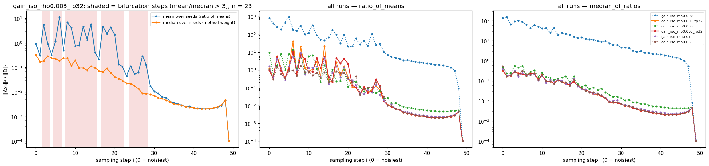
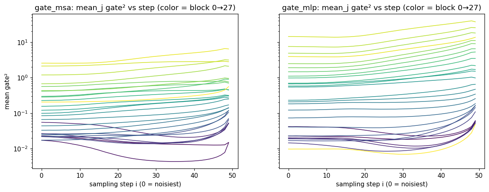
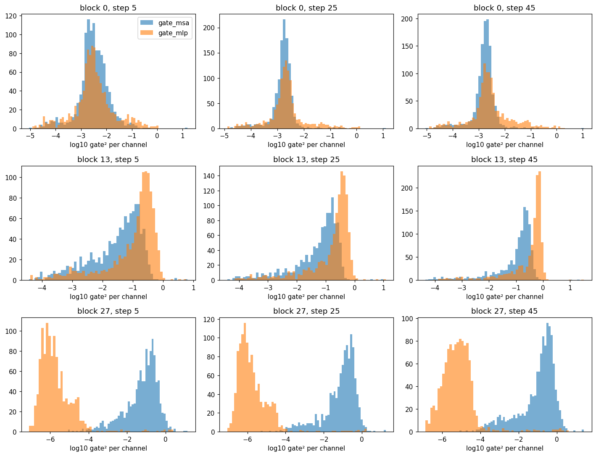
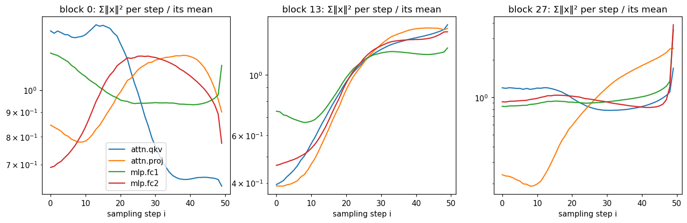
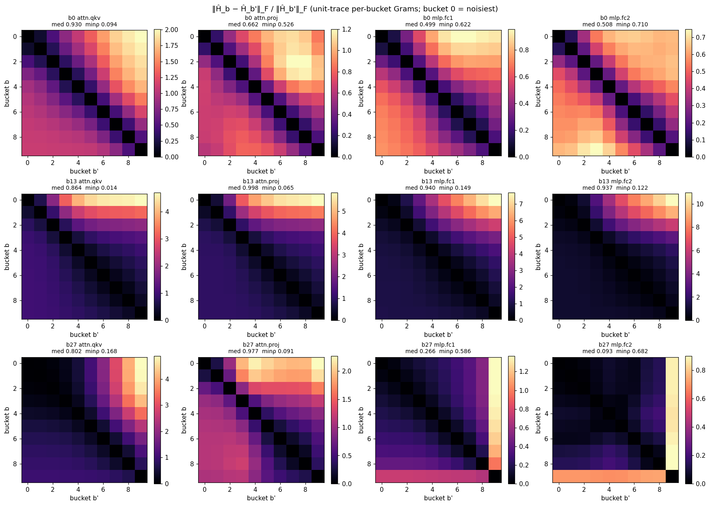
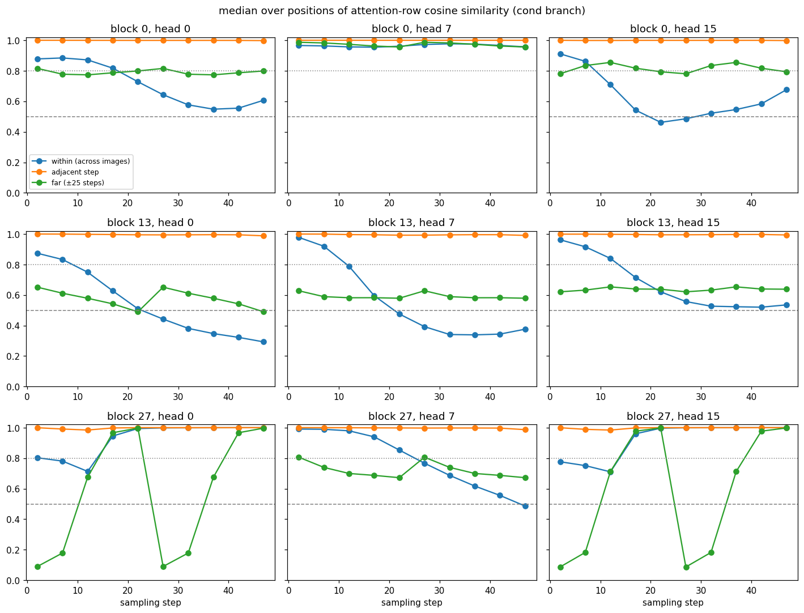

# Gate 1 — diagnostics (full precision)

_Generated by `scripts/make_gate1.py` from `results/stage1/*.json`._

Stage 1 seeds 2000–2015 (16 images, both CFG branches), cfg 1.5, DDIM-50. Step i = 0 is the noisiest step.

## 4.1 Sampler gain g_t²

| run | forward | ρ | estimator | max/median over t | argmax step | argmin step |
| --- | --- | ---: | --- | ---: | ---: | ---: |
| gain_iso_rho0.0001 | fp16-autocast | 0.0001 | ratio_of_means | 35.68 | 5 | 49 |
| gain_iso_rho0.0001 | fp16-autocast | 0.0001 | median_of_ratios | 15.59 | 1 | 49 |
| gain_iso_rho0.001_fp32 | fp32 | 0.001 | ratio_of_means | 499.71 | 6 | 49 |
| gain_iso_rho0.001_fp32 | fp32 | 0.001 | median_of_ratios | 16.35 | 0 | 49 |
| gain_iso_rho0.003 | fp16-autocast | 0.003 | ratio_of_means | 169.80 | 6 | 49 |
| gain_iso_rho0.003 | fp16-autocast | 0.003 | median_of_ratios | 15.19 | 3 | 49 |
| gain_iso_rho0.003_fp32 | fp32 | 0.003 | ratio_of_means | 102.96 | 6 | 49 |
| gain_iso_rho0.003_fp32 | fp32 | 0.003 | median_of_ratios | 17.01 | 0 | 49 |
| gain_iso_rho0.01 | fp16-autocast | 0.01 | ratio_of_means | 143.64 | 8 | 49 |
| gain_iso_rho0.01 | fp16-autocast | 0.01 | median_of_ratios | 18.43 | 0 | 49 |
| gain_iso_rho0.03 | fp16-autocast | 0.03 | ratio_of_means | 15.35 | 8 | 49 |
| gain_iso_rho0.03 | fp16-autocast | 0.03 | median_of_ratios | 25.68 | 0 | 49 |

**ρ-independence** (handoff: within 10%). Median over steps of |log ratio| between paired runs, and the fraction of steps whose two estimates differ by more than 10%:

| pair | estimator | median abs ratio-1 | steps > 10% off |
| --- | --- | ---: | ---: |
| gain_iso_rho0.01 vs gain_iso_rho0.03 | ratio_of_means | 0.226 | 41/50 |
| gain_iso_rho0.01 vs gain_iso_rho0.03 | median_of_ratios | 0.108 | 26/50 |
| gain_iso_rho0.003 vs gain_iso_rho0.01 | ratio_of_means | 0.691 | 47/50 |
| gain_iso_rho0.003 vs gain_iso_rho0.01 | median_of_ratios | 0.660 | 47/50 |
| gain_iso_rho0.001_fp32 vs gain_iso_rho0.003_fp32 | ratio_of_means | 0.054 | 23/50 |
| gain_iso_rho0.001_fp32 vs gain_iso_rho0.003_fp32 | median_of_ratios | 0.001 | 0/50 |

**fp16 rounding floor:** `gain_iso_rho0.0001` (ρ = 0.0001, signal ≈ 0) gives an apparent gain2 of 27 (median over steps): ‖Δx₀‖² there is pure rounding chaos, so fp16 finite differences cannot resolve the linear gain.

**Chosen for Stage 2:** `gain_iso_rho0.003_fp32`, estimator `median`. Deviation from the handoff's ratio-of-means at rho=0.01 (fp16). (1) In the fp16 sampler, rounding chaos sets a floor on ||dx0||^2 (at rho=1e-4 the apparent gain2 is 10^1-10^3), so lowering rho as instructed is impossible in fp16; the probe was rerun with an fp32 forward. (2) Even in fp32 the ratio of means is not rho-independent: 1-2 of 16 seeds sit near a trajectory bifurcation, their linear gain keeps growing as rho shrinks, and they dominate the mean. The median over seeds of the per-seed ratio is rho-independent in fp32 (1e-3 vs 3e-3: see table) and is used for Stage 2. Ratio-of-means remains a Stage 3 ablation.

Chosen curve: max/median = 17.01, monotone non-increasing: False.

Approved (RESPONSE to the Stage 2 report, item 1): the fp32 median-over-seeds curve is the method's weight. Both curves are kept in `results/stage1/gain.json`; steps where mean/median > 3 are marked as bifurcation steps.

## 4.2 Gate energies

| block | msa max/med (t) | msa dead | msa K4 inertia | mlp max/med (t) | mlp dead | mlp K4 inertia |
| ---: | ---: | ---: | ---: | ---: | ---: | ---: |
| 0 | 1.56 | 0.020 | 0.330 | 2.71 | 0.040 | 0.312 |
| 1 | 2.89 | 0.016 | 0.329 | 1.90 | 0.058 | 0.327 |
| 2 | 1.65 | 0.010 | 0.352 | 3.12 | 0.016 | 0.345 |
| 3 | 2.80 | 0.000 | 0.299 | 3.79 | 0.000 | 0.303 |
| 4 | 2.69 | 0.000 | 0.326 | 4.61 | 0.000 | 0.307 |
| 5 | 3.94 | 0.000 | 0.314 | 5.88 | 0.000 | 0.324 |
| 6 | 4.53 | 0.000 | 0.360 | 9.43 | 0.000 | 0.328 |
| 7 | 3.00 | 0.000 | 0.324 | 5.90 | 0.000 | 0.246 |
| 8 | 4.49 | 0.001 | 0.304 | 4.06 | 0.000 | 0.273 |
| 9 | 3.62 | 0.001 | 0.298 | 2.35 | 0.000 | 0.280 |
| 10 | 3.22 | 0.000 | 0.336 | 1.96 | 0.000 | 0.295 |
| 11 | 2.40 | 0.003 | 0.350 | 1.72 | 0.000 | 0.313 |
| 12 | 2.06 | 0.003 | 0.357 | 1.91 | 0.000 | 0.273 |
| 13 | 2.03 | 0.002 | 0.313 | 2.14 | 0.000 | 0.332 |
| 14 | 1.70 | 0.003 | 0.365 | 1.55 | 0.000 | 0.372 |
| 15 | 1.77 | 0.005 | 0.326 | 1.86 | 0.000 | 0.311 |
| 16 | 1.51 | 0.003 | 0.313 | 2.22 | 0.001 | 0.263 |
| 17 | 1.52 | 0.001 | 0.277 | 2.34 | 0.000 | 0.271 |
| 18 | 1.18 | 0.000 | 0.289 | 2.59 | 0.000 | 0.266 |
| 19 | 2.14 | 0.003 | 0.291 | 3.23 | 0.000 | 0.245 |
| 20 | 1.35 | 0.000 | 0.238 | 3.06 | 0.000 | 0.260 |
| 21 | 1.11 | 0.001 | 0.243 | 3.31 | 0.000 | 0.260 |
| 22 | 1.78 | 0.002 | 0.270 | 3.18 | 0.000 | 0.289 |
| 23 | 2.21 | 0.003 | 0.275 | 2.79 | 0.000 | 0.270 |
| 24 | 1.94 | 0.001 | 0.219 | 2.63 | 0.000 | 0.200 |
| 25 | 1.12 | 0.003 | 0.250 | 2.18 | 0.000 | 0.256 |
| 26 | 1.94 | 0.004 | 0.255 | 2.69 | 0.000 | 0.327 |
| 27 | 2.41 | 0.000 | 0.245 | 5.14 | 0.767 | 0.139 |

Blocks with mean-energy max/median ≥ 3 and inertia ≤ 0.5: gate_msa 5 [5, 6, 8, 9, 10]; gate_mlp 12 [2, 3, 4, 5, 6, 7, 8, 19, 20, 21, 22, 27]; either gate 14.

## 4.3 Gram trace vs step

## 4.4 Do per-bucket Grams disagree?

| block.layer | median off-diag rel. Frobenius | min Spearman | median Spearman | median top-32 overlap | differs? |
| --- | ---: | ---: | ---: | ---: | --- |
| b0.attn.qkv | 0.930 | 0.094 | 0.432 | 0.488 | yes |
| b0.attn.proj | 0.662 | 0.526 | 0.688 | 0.465 | yes |
| b0.mlp.fc1 | 0.499 | 0.622 | 0.801 | 0.797 | yes |
| b0.mlp.fc2 | 0.508 | 0.710 | 0.838 | 0.622 | yes |
| b13.attn.qkv | 0.864 | 0.014 | 0.487 | 0.431 | yes |
| b13.attn.proj | 0.998 | 0.065 | 0.449 | 0.475 | yes |
| b13.mlp.fc1 | 0.940 | 0.149 | 0.495 | 0.453 | yes |
| b13.mlp.fc2 | 0.937 | 0.122 | 0.546 | 0.404 | yes |
| b27.attn.qkv | 0.802 | 0.168 | 0.770 | 0.541 | yes |
| b27.attn.proj | 0.977 | 0.091 | 0.450 | 0.515 | yes |
| b27.mlp.fc1 | 0.266 | 0.586 | 0.948 | 0.407 | yes |
| b27.mlp.fc2 | 0.093 | 0.682 | 0.991 | 0.400 | yes |

12/12 (block, layer) pairs differ (median rel. Frobenius ≥ 0.10 or min Spearman ≤ 0.9).

## 4.5 Token-norm sinks

| block.layer | worst max/median over buckets |
| --- | ---: |
| b0.attn.qkv | 4.0 |
| b0.attn.proj | 2.1 |
| b0.mlp.fc1 | 1.7 |
| b0.mlp.fc2 | 4.5 |
| b13.attn.qkv | 3.5 |
| b13.attn.proj | 6.3 |
| b13.mlp.fc1 | 3.3 |
| b13.mlp.fc2 | 6.3 |
| b27.attn.qkv | 7.6 |
| b27.attn.proj | 7.3 |
| b27.mlp.fc1 | 5.2 |
| b27.mlp.fc2 | 7.0 |

Sinks (max/median > 100) present: **False** → Gate 2 λ default: λ = 1 only (λ = 0.5 stays a Stage 3 arm).

## 4.6 Verdict

- (a) gain2 max/median ≥ 3 (chosen estimator): **True** (17.01). Holds under every estimator/ρ above: **True**.
- (b) gate-energy criterion in ≥ 10 blocks: gate_msa False (5), gate_mlp True (12), either gate True (14).
- Gram dissimilarity in ≥ half of (block, layer) pairs: **True** (12/12).
- STOP conditions: low-gain-and-flat-gates False; Grams scalar multiples everywhere False.

**Gate 1: PASS**

## 4.7 Attention-pattern stability per grid position (log-only)

| block | head | step | within med | within p10 | adjacent med | far med | frac within > 0.8 |
| ---: | ---: | ---: | ---: | ---: | ---: | ---: | ---: |
| 0 | 0 | 2 | 0.878 | 0.857 | 1.000 | 0.816 | 1.000 |
| 0 | 0 | 7 | 0.884 | 0.866 | 1.000 | 0.778 | 1.000 |
| 0 | 0 | 12 | 0.871 | 0.850 | 1.000 | 0.773 | 1.000 |
| 0 | 0 | 17 | 0.817 | 0.754 | 0.999 | 0.787 | 0.641 |
| 0 | 0 | 22 | 0.728 | 0.622 | 0.999 | 0.799 | 0.082 |
| 0 | 0 | 27 | 0.643 | 0.544 | 0.999 | 0.816 | 0.000 |
| 0 | 0 | 32 | 0.577 | 0.490 | 0.999 | 0.778 | 0.000 |
| 0 | 0 | 37 | 0.548 | 0.475 | 0.999 | 0.773 | 0.000 |
| 0 | 0 | 42 | 0.555 | 0.490 | 0.999 | 0.787 | 0.000 |
| 0 | 0 | 47 | 0.607 | 0.563 | 0.998 | 0.799 | 0.000 |
| 0 | 7 | 2 | 0.966 | 0.957 | 1.000 | 0.987 | 1.000 |
| 0 | 7 | 7 | 0.963 | 0.954 | 1.000 | 0.982 | 1.000 |
| 0 | 7 | 12 | 0.957 | 0.947 | 1.000 | 0.973 | 1.000 |
| 0 | 7 | 17 | 0.955 | 0.943 | 1.000 | 0.962 | 1.000 |
| 0 | 7 | 22 | 0.961 | 0.948 | 1.000 | 0.956 | 1.000 |
| 0 | 7 | 27 | 0.972 | 0.959 | 1.000 | 0.987 | 1.000 |
| 0 | 7 | 32 | 0.977 | 0.966 | 1.000 | 0.982 | 1.000 |
| 0 | 7 | 37 | 0.975 | 0.966 | 1.000 | 0.973 | 1.000 |
| 0 | 7 | 42 | 0.966 | 0.958 | 1.000 | 0.962 | 1.000 |
| 0 | 7 | 47 | 0.957 | 0.945 | 1.000 | 0.956 | 1.000 |
| 0 | 15 | 2 | 0.911 | 0.903 | 1.000 | 0.780 | 1.000 |
| 0 | 15 | 7 | 0.862 | 0.846 | 0.999 | 0.834 | 1.000 |
| 0 | 15 | 12 | 0.709 | 0.675 | 0.999 | 0.855 | 0.000 |
| 0 | 15 | 17 | 0.542 | 0.499 | 1.000 | 0.817 | 0.000 |
| 0 | 15 | 22 | 0.462 | 0.409 | 1.000 | 0.793 | 0.000 |
| 0 | 15 | 27 | 0.485 | 0.407 | 0.999 | 0.780 | 0.000 |
| 0 | 15 | 32 | 0.522 | 0.428 | 0.999 | 0.834 | 0.000 |
| 0 | 15 | 37 | 0.546 | 0.456 | 1.000 | 0.855 | 0.000 |
| 0 | 15 | 42 | 0.583 | 0.508 | 1.000 | 0.817 | 0.000 |
| 0 | 15 | 47 | 0.676 | 0.621 | 0.998 | 0.793 | 0.000 |
| 13 | 0 | 2 | 0.873 | 0.865 | 1.000 | 0.651 | 1.000 |
| 13 | 0 | 7 | 0.833 | 0.813 | 0.999 | 0.612 | 0.984 |
| 13 | 0 | 12 | 0.749 | 0.716 | 0.998 | 0.578 | 0.035 |
| 13 | 0 | 17 | 0.627 | 0.592 | 0.996 | 0.542 | 0.000 |
| 13 | 0 | 22 | 0.509 | 0.468 | 0.995 | 0.490 | 0.000 |
| 13 | 0 | 27 | 0.442 | 0.394 | 0.994 | 0.651 | 0.000 |
| 13 | 0 | 32 | 0.381 | 0.337 | 0.995 | 0.612 | 0.000 |
| 13 | 0 | 37 | 0.347 | 0.307 | 0.995 | 0.578 | 0.000 |
| 13 | 0 | 42 | 0.322 | 0.281 | 0.995 | 0.542 | 0.000 |
| 13 | 0 | 47 | 0.293 | 0.254 | 0.988 | 0.490 | 0.000 |
| 13 | 7 | 2 | 0.978 | 0.967 | 0.999 | 0.628 | 1.000 |
| 13 | 7 | 7 | 0.920 | 0.870 | 0.999 | 0.589 | 1.000 |
| 13 | 7 | 12 | 0.788 | 0.691 | 0.996 | 0.582 | 0.367 |
| 13 | 7 | 17 | 0.595 | 0.514 | 0.995 | 0.582 | 0.000 |
| 13 | 7 | 22 | 0.475 | 0.387 | 0.992 | 0.579 | 0.000 |
| 13 | 7 | 27 | 0.393 | 0.326 | 0.992 | 0.628 | 0.000 |
| 13 | 7 | 32 | 0.341 | 0.289 | 0.994 | 0.589 | 0.000 |
| 13 | 7 | 37 | 0.339 | 0.288 | 0.995 | 0.582 | 0.000 |
| 13 | 7 | 42 | 0.344 | 0.297 | 0.995 | 0.582 | 0.000 |
| 13 | 7 | 47 | 0.376 | 0.322 | 0.991 | 0.579 | 0.000 |
| 13 | 15 | 2 | 0.962 | 0.956 | 0.999 | 0.621 | 1.000 |
| 13 | 15 | 7 | 0.916 | 0.898 | 0.999 | 0.632 | 1.000 |
| 13 | 15 | 12 | 0.840 | 0.780 | 0.998 | 0.653 | 0.801 |
| 13 | 15 | 17 | 0.714 | 0.646 | 0.997 | 0.639 | 0.035 |
| 13 | 15 | 22 | 0.621 | 0.562 | 0.995 | 0.638 | 0.008 |
| 13 | 15 | 27 | 0.557 | 0.501 | 0.995 | 0.621 | 0.008 |
| 13 | 15 | 32 | 0.527 | 0.456 | 0.995 | 0.632 | 0.004 |
| 13 | 15 | 37 | 0.523 | 0.450 | 0.996 | 0.653 | 0.004 |
| 13 | 15 | 42 | 0.520 | 0.454 | 0.997 | 0.639 | 0.004 |
| 13 | 15 | 47 | 0.535 | 0.472 | 0.994 | 0.638 | 0.000 |
| 27 | 0 | 2 | 0.803 | 0.781 | 1.000 | 0.090 | 0.566 |
| 27 | 0 | 7 | 0.781 | 0.750 | 0.991 | 0.178 | 0.172 |
| 27 | 0 | 12 | 0.713 | 0.676 | 0.984 | 0.675 | 0.051 |
| 27 | 0 | 17 | 0.945 | 0.887 | 0.998 | 0.967 | 0.938 |
| 27 | 0 | 22 | 0.994 | 0.968 | 1.000 | 0.997 | 0.938 |
| 27 | 0 | 27 | 0.998 | 0.984 | 1.000 | 0.090 | 0.938 |
| 27 | 0 | 32 | 0.999 | 0.987 | 1.000 | 0.178 | 0.938 |
| 27 | 0 | 37 | 1.000 | 0.990 | 1.000 | 0.675 | 0.938 |
| 27 | 0 | 42 | 1.000 | 0.993 | 1.000 | 0.967 | 0.938 |
| 27 | 0 | 47 | 1.000 | 0.997 | 1.000 | 0.997 | 0.938 |
| 27 | 7 | 2 | 0.991 | 0.989 | 1.000 | 0.807 | 1.000 |
| 27 | 7 | 7 | 0.989 | 0.988 | 1.000 | 0.740 | 1.000 |
| 27 | 7 | 12 | 0.979 | 0.977 | 0.999 | 0.700 | 1.000 |
| 27 | 7 | 17 | 0.940 | 0.928 | 0.999 | 0.687 | 1.000 |
| 27 | 7 | 22 | 0.853 | 0.830 | 0.998 | 0.672 | 1.000 |
| 27 | 7 | 27 | 0.767 | 0.727 | 0.997 | 0.807 | 0.102 |
| 27 | 7 | 32 | 0.687 | 0.630 | 0.998 | 0.740 | 0.000 |
| 27 | 7 | 37 | 0.617 | 0.565 | 0.998 | 0.700 | 0.000 |
| 27 | 7 | 42 | 0.556 | 0.505 | 0.997 | 0.687 | 0.000 |
| 27 | 7 | 47 | 0.486 | 0.439 | 0.987 | 0.672 | 0.000 |
| 27 | 15 | 2 | 0.776 | 0.749 | 1.000 | 0.087 | 0.105 |
| 27 | 15 | 7 | 0.751 | 0.709 | 0.989 | 0.182 | 0.027 |
| 27 | 15 | 12 | 0.710 | 0.659 | 0.984 | 0.712 | 0.047 |
| 27 | 15 | 17 | 0.960 | 0.908 | 0.998 | 0.977 | 0.938 |
| 27 | 15 | 22 | 0.996 | 0.979 | 1.000 | 0.998 | 0.938 |
| 27 | 15 | 27 | 0.999 | 0.990 | 1.000 | 0.087 | 0.938 |
| 27 | 15 | 32 | 1.000 | 0.992 | 1.000 | 0.182 | 0.938 |
| 27 | 15 | 37 | 1.000 | 0.993 | 1.000 | 0.712 | 0.938 |
| 27 | 15 | 42 | 1.000 | 0.993 | 1.000 | 0.977 | 0.938 |
| 27 | 15 | 47 | 1.000 | 0.997 | 1.000 | 0.998 | 0.938 |

P recomputed from the qkv output; P@V vs the SDPA output: max relative Frobenius error 2.33e-04 (fused attention left untouched, so block outputs are unchanged by construction).

**per-(position, bucket) pooling not plausible** — steps (of 10) with head-median within ≥ 0.8 and far ≤ 0.5: block 0: 0, block 13: 0, block 27: 3.
Within-image agreement is high at the noisy steps and falls with denoising (content-dependent attention), while patterns 25 steps apart mostly stay similar (far > 0.5) except block 27 heads 0/15.
